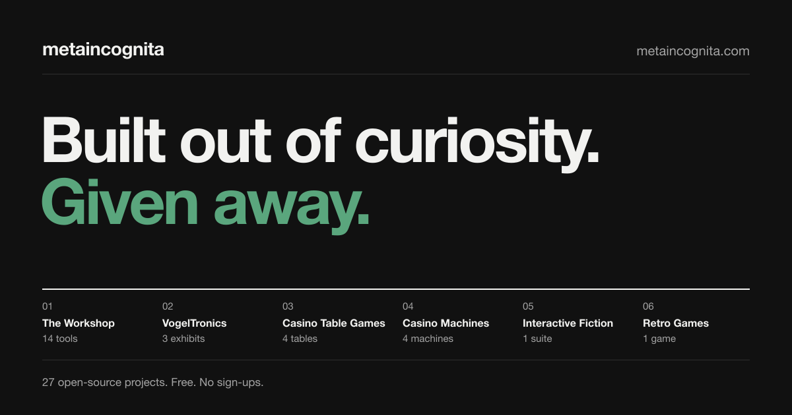

# metaincognita

[](LICENSE)
&nbsp;
&nbsp;
&nbsp;
&nbsp;
&nbsp;[](https://metaincognita.com)

The landing page for **metaincognita** — a small, curated collection of open-source
projects built out of curiosity: casino games rebuilt as **simulations** that show their
math, **workshop** tools for writing, retro computing, the home and everyday office
work, **frotz, Inc.** — a suite
of browser tools for 1980s Infocom-style interactive fiction — **games** built for
nothing but fun, and playable homages to **VogelTronics**, a completely
fictional Illinois toy company invented so the retro-toy recreations step on no one's
trademarks.

> **Not a gambling site.** No real money, no sign-ups — just open-source apps, free to
> use and free to fork. (Some games ship a scripted AI opponent — poker bots, a rival
> slot car — but no app calls an LLM or other generative model.)

**Live:** https://metaincognita.com

This repository is *only* the landing page. Each project below is its own deployment and
its own repository; the page simply links out to them. Most live under
[`github.com/cschweda`](https://github.com/cschweda); five tools written for work live
under [`github.com/ICJIA`](https://github.com/ICJIA), and one that is still in
development has no repository yet.

The page runs in floor order: **The Workshop**, **VogelTronics**, **Casino Table Games**,
**Casino Machines**, **Interactive Fiction** and **Retro Games**. The top navigation
numbers them 01 to 06 and folds into a menu on narrow screens.

## The collection

### The Workshop — tools

| Tool | Live | Source | What it is |
| --- | --- | --- | --- |
| Drafter | `drafter.dev` | [source](https://github.com/cschweda/drafter) | Screenplays and stage plays in plain-text Fountain, with the formatted pages building as you type; novels in Markdown. |
| Fugløy | `fugloy.dev` | [source](https://github.com/cschweda/fugloy) | A TRS-80 Model I/III reverse-engineering toolkit: byte-exact disassembler, explaining workbench, emulator. |
| OpenMantel | `openmantel.com` | [source](https://github.com/cschweda/openmantel) | A self-hosted digital picture frame for every screen in the house. |
| aiden-portal | `aiden-portal.netlify.app` (demo) | [source](https://github.com/cschweda/aiden-portal) | A dashboard for a Fellow Aiden coffee brewer — live brew trace, profiles, schedules, brew log, descale tally — reachable only over Tailscale. The link is the demo, on invented data. |
| ICJIA Markdown Editor 2.0 | `markdown.icjia.cloud` | [source](https://github.com/ICJIA/icjia-markdown-editor-2026) | An accessible Markdown editor for ICJIA researchers: write, preview and export. |
| Ipsumify | `ipsumify.com` | [source](https://github.com/ICJIA/ipsumify-next-2026) | Lorem ipsum placeholder text with Markdown support, themed variants and a free public API. |
| Squish | `squish.icjia.app` | [source](https://github.com/ICJIA/icjia-squish-2026) | Image compression in the browser, with a real-time preview and no uploads. |
| ICJIA Accessibility Audit | `audit.icjia.app` | [source](https://github.com/ICJIA/file-accessibility-audit) | An accessibility checker for PDF, Word, PowerPoint and Excel: a WCAG 2.1 AA score with fix-it guidance. |
| ICJIA Accessibility Portal | `accessibility.icjia.app` | [source](https://github.com/ICJIA/icjia-accessibility-portal) | A countdown to the WCAG 2.1 AA deadline for ADA Title II, with FAQs and guidance for Illinois state agencies. |
| zoneblick | `zoneblick.com` | [source](https://github.com/cschweda/zoneblick) | A self-hosted DNS zone watchdog, written in Rust: it asks every authoritative nameserver directly and checks the answers, so you know when your DNS drifts. An early release. |
| v6blick | `cschweda.github.io/v6blick` | [source](https://github.com/cschweda/v6blick) | An IPv6 readiness test for websites, written in Rust: it connects to a site over IPv4 and over IPv6 separately, compares the two, and says what breaks for a visitor without IPv4 and how to fix it. An early build, with no domain of its own, so the card links its GitHub Pages site. |
| Fotobogen | `fotobogen.com` | [source](https://github.com/cschweda/fotobogen) | Free, open-source software for running your own photo website: install it, upload your pictures, publish them at your own address. |
| Omsett | `omsett.com` | [source](https://github.com/cschweda/omsett) | A free, open-source file converter that runs in the browser (images, audio, documents, data, archives, fonts, subtitles, common video), so your files never touch a server. |
| Utenat | `utenat.com` (placeholder) | no repo yet | Free, open-source software for memorizing anything you need to say aloud: a monologue, a speech, a poem, a part in a scene. **In development**; its card carries a label saying so. |

The five ICJIA tools (the Markdown editor, Ipsumify, Squish, the Accessibility Audit and the Accessibility Portal)
were written for work at ICJIA, and for my own use; their source lives under the ICJIA
GitHub organisation.

Utenat is **in development**. It links to a placeholder page announcing it, has no
source link because there is no repository yet, and its card carries an
"In development" label in the top-right corner of its picture. (Utenat's og:image
prints its own "In development" label in that corner; the copy in `public/workshop/`
has it painted out so the two do not collide.)

**In-development tools always go at the bottom of The Workshop**, however many there
are: a finished tool is added above them, never below. A test holds the catalog to it.
The page draws them as a group of their own, set apart from the live tools under a
hairline rule labelled "In development". Any card with a `status` joins that group;
nothing else is needed.

The Workshop's cards lead with each app's own og:image, copied into
`public/workshop/` as WebP (the CSP is `img-src 'self'`, so the cards never load
another origin's image). aiden-portal has no og:image of its own (it is not a public
site), so its picture was made for this page. There are fourteen tools, three to a row
on a wide screen: thirteen live, then the one in development.

### VogelTronics — A Fictional History

Playable homages to **VogelTronics**, a completely fictional Illinois toy company
(1961–1983) invented from scratch — founder, catalog, logos and all — so these
recreations owe nothing to Hasbro, Mattel, Milton Bradley or anyone else's
trademarks. The [corporate history](https://vogeltronics.com/) is the shared lore.
**Gridiron** is the first playable cabinet; **Rovacon**, the flagship programmable rover,
comes next.

The section is titled **VogelTronics: A Fictional History**, so the page says plainly
that the company is invented; the copy beneath the title reads straight, and the footer's
fine print says which real trademarks are not used.

| Exhibit | Live | Source | What it is |
| --- | --- | --- | --- |
| VogelTronics: The Whole Story | `vogeltronics.com` | [source](https://github.com/cschweda/vogeltronics-history) | The magazine-style corporate history, era by era, 1961 to the 1983 crash. |
| Rovacon Voice Bench | `vogelvox.vogeltronics.com` | [source](https://github.com/cschweda/vogeltronics-vogel-vox) | Votrax SC-01-class formant speech synthesis in TypeScript — type a phrase, hear 1980 arcade speech, export WAV. |
| Gridiron | `gridiron.vogeltronics.com` | [source](https://github.com/cschweda/vogeltronics-gridiron-i) | The 1977 LED football handheld, solo — one bright blip against five tacklers, four downs, a kick on fourth. Keyboard-first. |

### Casino Table Games — simulations

| Simulation | Live | Source | What it is |
| --- | --- | --- | --- |
| No-Limit Hold’em | `holdem.metaincognita.com` | [source](https://github.com/cschweda/metaincognita-holdem) | Texas Hold’em vs. intelligent bots, with live equity, outs, pot odds and ranges. |
| Blackjack Trainer | `blackjack.metaincognita.com` | [source](https://github.com/cschweda/metaincognita-blackjack) | Basic-strategy coaching and Hi-Lo card counting on official-rulebook rules. |
| Craps Simulator | `craps.metaincognita.com` | [source](https://github.com/cschweda/metaincognita-craps) | Learn the line, the odds bets and where the edge hides. |
| Roulette Trainer | `roulette.metaincognita.com` | [source](https://github.com/cschweda/metaincognita-roulette) | A real forward-physics wheel, proven fair by simulation. |

### Casino Machines — simulations

| Simulation | Live | Source | What it is |
| --- | --- | --- | --- |
| Slots Simulator | `slots.metaincognita.com` | [source](https://github.com/cschweda/metaincognita-slots) | Reel strips, virtual-reel weights and exact house edge across eight archetypes. |
| Video Poker Trainer | `videopoker.metaincognita.com` | [source](https://github.com/cschweda/metaincognita-video-poker) | Optimal play, pay-table literacy and bankroll management. |
| Pachinko Parlor | `pachinko.metaincognita.com` | [source](https://github.com/cschweda/metaincognita-pachinko) | Ball-drop physics and payout pockets, with the odds laid bare. |
| Flameout | `flameout.metaincognita.com` | [source](https://github.com/cschweda/metaincognita-flameout) | A crash-game simulator: climb, cash out, then see why the house always wins. |

### Interactive Fiction — frotz, Inc.

Infocom wrote its 1980s text adventures for the **Z-machine**, an imaginary computer, so
one story file could run on every home computer of the day: you type commands and the game
answers in prose. **[frotz, Inc.](https://frotzinc.com)** is the umbrella for the Z-machine
tools — one project with many tools, so it gets a zone of its own and a single full-width
*showcase* card (its og:image beside the copy, with the suite listed).

| Project | Live | Source | What it is |
| --- | --- | --- | --- |
| frotz, Inc. | `frotzinc.com` | [source](https://github.com/cschweda/frotzinc) | Instruments for the Z-machine: write, build, play, inspect and ship Infocom-style text adventures in the browser. |

The suite today:

- **frotzsmith** ([source](https://github.com/cschweda/frotzsmith)) — a browser IDE for Inform 6 and ZIL; the real compilers run as WebAssembly, building Z-machine or Glulx story files client-side, with inline play and a skein test runner.
- **frotzplay** — a Z-machine player built for screen readers and strict security policies; story files are never uploaded. It ships as part of frotzlens.
- **frotzlens** ([source](https://github.com/cschweda/frotzlens)) — a story-file inspector: header, object tree, dictionary, grammar, strings and cross-referenced disassembly.

Still to come: a debugger (frotztrace), a release packager (frotzpack), a linter
(frotzlint) and a regression tester (frotzcheck). They join the frotz, Inc. card's
suite list, not the floor.

### Retro Games — just for fun

| Game | Live | Source | What it is |
| --- | --- | --- | --- |
| AFX Slot Car Simulator | `slotcar.netlify.app` | [source](https://github.com/cschweda/slotcarsim) | Photorealistic 1970s Aurora AFX HO slot cars — analog trigger throttle, real deslot physics, oval and figure-eight, race a fallible AI or practice solo. Open source. |

## Design

Swiss, and dark (v3.0.0; it replaced the neon casino-floor design).

- **Grid:** twelve columns, 24px gutters, 1440px maximum width with 64px margins
  (`.wrap` and `.g12` in `main.css`). Cards run three to a row on a wide screen, two on a
  tablet, one on a phone; the frotz, Inc. showcase takes a whole row.
- **Type:** one grotesque. **Helvetica Neue** where the system has it, then
  **Inter Tight** (self-hosted by `@nuxt/fonts`, the closest free match), then Arial.
- **Colour:** an ink ground (`#111111`), paper-white headings, two greys for body text
  and captions, hairline rules, and **one accent, a muted signal green (`#5aa67d`)**,
  used sparingly: "Given away." in the opening, "VogelTronics" in its section title
  (a zone's optional `titleAccent`), the section numbers, and the focus ring.
  All tokens live in the `@theme` block of `app/assets/css/main.css`.
- **Cards:** every card leads with its app's own og:image, copied into
  `public/workshop/` as WebP (the CSP is `img-src 'self'`). A card without one would
  show its lucide pictogram instead; none does today. Under the picture: the badge and its caption, the title, the description, then the live address
  and the source link. The whole card is one click target (the live link stretches
  over it); the source link sits above it.
- **Navigation:** a sticky top bar with the six zones, numbered. Below 1200px wide it
  folds into a **Menu** button (`aria-expanded`, closes on Escape or on a link).
- **Accessibility:** WCAG 2.1 AA. Running text is at least 7.4:1 against the ground and
  the accent is 6.5:1; every interactive target is at least 44px; one visible focus
  ring everywhere; no animation except the sound switch's equaliser, and that stops
  under `prefers-reduced-motion`.

The neon design's line-art scenes (`CabinetArt.vue`) and the catalog's per-card
`accent` colours are not drawn by this design; both are kept (the scenes still tested)
for reuse.

## Tech stack

- **[Nuxt 4](https://nuxt.com)** with the `app/` directory structure, prerendered to static HTML (SSG)
- **[Nuxt UI 4](https://ui.nuxt.com)** + **Tailwind CSS v4**
- Self-hosted fonts via `@nuxt/fonts`: **Inter Tight**, behind Helvetica Neue in the stack
- Lucide icons (`@iconify-json/lucide`, bundled at build — no runtime Iconify calls)
- [Plausible](https://plausible.io) analytics (`@nuxtjs/plausible`)
- **pnpm** · **Node 22**

## Floor audio

The landing page can play an ambient casino loop. **It is off on every page load,
without exception, and nothing is remembered.** A landing page does not get to make
noise at someone who never asked for it.

Sound is turned on only by the **Floor audio** switch in the footer. Reload, revisit, or come back
tomorrow and you are back to silence. There is deliberately **no persisted preference**:
if we stored an "on" choice, a reload would leave the switch reading *on* over a silent
page (browsers won't start audio without a gesture), and one stray click would bring the
noise back unannounced. Nothing stored means nothing to be surprised by.

Nothing is downloaded until the switch is actually flipped — `preload="none"`, and the
`<audio>` element isn't even constructed until then — so first paint is byte-for-byte
identical whether a visitor ever turns sound on or not.

`play()` is never called outside a user-gesture handler. Browsers reject audible autoplay
anyway, but it is also a WCAG 1.4.2 (Audio Control) failure and a dark pattern besides.
The switch **is** the gesture.

The equaliser bars on the switch read from whether the floor is *actually audible*, not
from the setting — so the control can never claim to be playing over a silent page.

**Shipped assets** (in `public/audio/`):

| File | Codec | Size |
|---|---|---|
| `casino-floor.webm` | Opus 40k stereo | 451 KB |
| `casino-floor.m4a` | AAC 48k mono | 563 KB |

Both are a seamless 93.944s loop.

### Regenerating them

The raw source is a freesound_community upload via Pixabay
(Pixabay Content License — commercial use, no attribution required; credited here
anyway). It is 98s, stereo, 24 kHz, 160 kbps, and has a **mean volume of −32.5 dB
with peaks at 0.0 dB** — a quiet crowd bed with full-scale transients buried in it.
Untreated it is either inaudible or it spikes, so it must be compressed before it can
work as a background loop.

Normalise **first**, then loop, so the crossfade blends already-levelled audio:

```bash
SRC=audio/freesound_community-bruit-2-casino-56939.mp3

# 1. high-pass the sub-60Hz rumble, compress, normalise → mean −21.8 dB, peak −1.2 dB
ffmpeg -i "$SRC" -af "highpass=f=60,loudnorm=I=-18:TP=-1.5:LRA=7" -ar 24000 -ac 2 norm.wav

# 2. seamless loop: crossfade the tail into the head. D=97.944, X=4 → L=93.944
ffmpeg -i norm.wav -filter_complex "\
[0:a]atrim=0:4,asetpts=N/SR/TB[head];\
[0:a]atrim=4:93.944,asetpts=N/SR/TB[body];\
[0:a]atrim=93.944:97.944,asetpts=N/SR/TB[tail];\
[tail][head]acrossfade=d=4:c1=tri:c2=tri[xf];\
[xf][body]concat=n=2:v=0:a=1[out]" -map "[out]" -ar 24000 -ac 2 loop.wav

# 3. encode
ffmpeg -i loop.wav -c:a libopus -b:a 40k -vbr on -application audio -ac 2 \
  public/audio/casino-floor.webm
ffmpeg -i loop.wav -c:a aac -b:a 48k -ac 1 -ar 24000 -movflags +faststart \
  public/audio/casino-floor.m4a
```

### Credits

Ambient casino beds by the **freesound_community** on
[Pixabay](https://pixabay.com/sound-effects/).

## Project structure

```
app/
  app.vue              # UApp wrapper + the sticky header
  app.config.ts        # Nuxt UI theme (green primary, neutral greys)
  assets/css/main.css  # design tokens, the 12-column grid, focus ring
  components/
    TheHeader.vue      # wordmark + numbered zone nav; folds into a Menu button
    TheHero.vue        # the thesis, the facts and the lede
    ZoneSign.vue       # a zone's number, name, count, title and sub
    GameCabinet.vue    # a card: plate (og:image or pictogram), badge, copy, links
    TheFooter.vue      # the claims, the GitHub link, the audio switch, fine print
    SoundSwitch.vue    # the floor-audio toggle, used inside TheFooter
    CabinetArt.vue     # line-art scenes from the neon design; not drawn in v3
  composables/
    useFloorAudio.ts   # audio preference + playback control
  data/catalog.ts      # zone-shaped data (zones, allItems)
  utils/
    countLabel.ts      # "14 tools", "1 suite"
    jsonLd.ts          # JSON-LD structured data builder
  pages/index.vue      # composes hero + zones + footer
public/
  audio/               # seamless casino-floor loops (WebM + M4A)
  og-image.png         # Swiss social share card (rendered from og-image.svg)
  workshop/            # the Workshop apps' og:images, as WebP card art
  apple-touch-icon.png # 180×180, full-bleed — iOS masks its own corners
  favicon.svg
nuxt.config.ts         # SEO/OG head, netlify_static preset, modules
netlify.toml           # security headers + CSP
```

## Adding a simulation or tool

Everything on the page is data-driven. Edit [`app/data/catalog.ts`](app/data/catalog.ts)
and append an item to a zone's `items` array:

```ts
{
  title: 'New Game',
  description: 'One plain line about what it teaches.',
  domain: 'new-game.metaincognita.com', // any bare hostname (the slot car lives on netlify.app); the live-link label
  repo: 'https://github.com/cschweda/new-game', // the card's "Source" link (omit only while there is no public repo)
  icon: 'dice-6',                        // any lucide name -> i-lucide-dice-6; the plate's pictogram
  accent: '#e0a92e',                     // kept in the data; not drawn by the Swiss design
  badge: 'True odds',                    // the card's label: the method, never a number
  badgeNote: 'one quiet caption',        // the caption beside it
  span: 'std'                            // see below
}
```

No template changes are needed — the cards, counts and navigation update automatically.
Every card carries a `shot` path: the app's og:image, saved as WebP under
`public/workshop/` (the catalog test checks each one exists and is used once). Use
`span: 'shot'` for a card in the three-column grid, or `span: 'showcase'` for an umbrella
project that takes a whole row and lists its `suite`.

Two optional fields cover an app that is not finished. Leave out `repo` and the card
shows no source link; the catalog test lists every such app by domain, so add it there
deliberately. Set `status: 'In development'` on a `shot` card and it moves into the
zone's "In development" group, with that text set into the top-right corner of its
picture. To add any app, convert its og:image first:

```bash
cwebp -q 82 -resize 1120 588 og.png -o public/workshop/new-tool.webp
```

## Develop

```bash
pnpm install
pnpm dev          # http://localhost:3000 (Nuxt picks the next free port if taken)
```

## Build

```bash
pnpm generate     # static site emitted to ./dist
pnpm preview      # preview the production build locally
```

## Deploy (Netlify)

Configured in [`netlify.toml`](netlify.toml):

- **Build command:** `pnpm generate`
- **Publish directory:** `dist`
- **Node version:** 22 (also pinned in `.nvmrc`)

Netlify builds production from `main`, and each production build is billed, while PR
Deploy Previews are free. So changes are batched: feature branches open PRs into the
long-lived `staging` branch, and `staging` is merged into `main` (a merge commit, never
a squash) only when a batch is ready to ship.

The `netlify_static` nitro preset generates `dist/_redirects` (unknown paths → the
prerendered 404) and `dist/_headers` (immutable caching for `/_nuxt/*` and `/_fonts/*`).
`netlify.toml` layers on the security headers nitro does not emit, including a
Content-Security-Policy scoped to self-hosted assets, inline styles/scripts Nuxt emits,
and Plausible.

The social share card is `public/og-image.png` (1200×630), referenced by the OG/Twitter
meta tags in `nuxt.config.ts`. Edit `public/og-image.svg` and re-render it with
`rsvg-convert -w 1200 -h 630 public/og-image.svg -o public/og-image.png`.

## Quality metrics

Measured against a gzip + immutable-cache server matching Netlify's behaviour:

**Lighthouse desktop:** Performance 100 · Accessibility 100 · Best Practices 100 · SEO 100

**Lighthouse mobile:** Performance 100 · Accessibility 100 · Best Practices 100 · SEO 100

**axe-core:** 0 violations at WCAG 2.1 AA (desktop and mobile); every text element passes contrast

## License

[MIT](LICENSE) © 2026 metaincognita — free to use, fork, and self-host.
